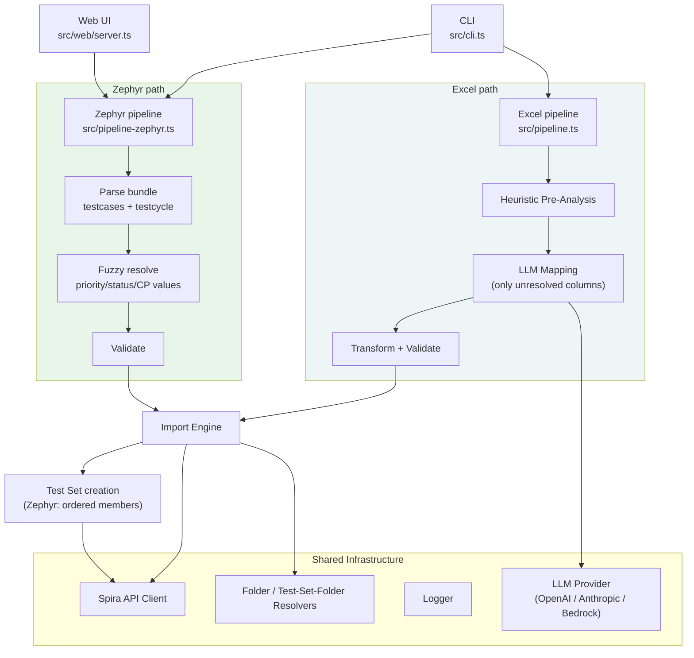

# SpiraTestCaseImporter

LLM-assisted artifact importer for Spira — uses heuristic pre-analysis and LLMs to map arbitrary Excel spreadsheets to Spira's data model. Also supports direct import from Zephyr Scale JSON bundles (no LLM needed).

---

## Quick Start for non-developers (web UI)

If you just want to import a **Zephyr Scale bundle** through a web page — no command line beyond a couple of steps — follow this.

**1. Install Node.js (one time).**
Download the **LTS** version from [nodejs.org](https://nodejs.org) and run the installer with the default options. This repo needs **Node 20.6 or newer** (the LTS build is fine).

**2. Get this project onto your computer.**
Either clone it with Git, or on the GitHub page click **Code → Download ZIP** and unzip it somewhere you can find.

**3. Open a terminal in the project folder.**
- Windows: open the unzipped folder in File Explorer, click the address bar, type `powershell`, and press Enter.
- macOS: right-click the folder → Services → **New Terminal at Folder**.

**4. Start the app:**

```bash
npm install
npm start
```

The first run installs dependencies and builds the app (this takes a minute). When it's ready you'll see a line like:

```
  Spira Importer UI → http://localhost:4321
```

**5. Open that address in your web browser.** Enter your Spira details on the **Settings** tab (and click *Test Connection*), then go to the **Import** tab to upload a Zephyr bundle and import it.

On later runs you only need `npm start`.

> Excel imports currently run through the command line (see below); the web UI handles Zephyr bundles.

---

## Quick Start (developers / CLI)

**Prerequisite:** Node.js **20.6+** (22 LTS recommended). The tool uses `--env-file`, native `fetch`, and `import.meta.dirname`, all of which require a recent Node.

### 1. Install

```bash
npm install
npm run build
```

### 2. Configure

Create a `.env` file (see `.env.example`):

```env
SPIRA_URL=https://your-instance.spiraservice.net
SPIRA_USERNAME=your-username
SPIRA_API_KEY={YOUR-API-KEY-GUID}
SPIRA_PROJECT_ID=1

LLM_PROVIDER=bedrock
LLM_MODEL=amazon.nova-lite-v1:0
AWS_REGION=us-east-1
AWS_ACCESS_KEY_ID=AKIA...
AWS_SECRET_ACCESS_KEY=...

SOURCE_PATH=./your-spreadsheet.xlsx
```

Supported LLM providers: `bedrock` (AWS), `openai`, `anthropic`.

> **Note:** `SOURCE_PATH` replaces the older `SOURCE_FILE` variable. Both are accepted for backward compatibility, but `SOURCE_PATH` is preferred since the value can be a file or a directory.

### 3. Run (dry-run first)

```bash
node --env-file=.env dist/cli.js --dry-run
```

For multi-sheet workbooks, specify the sheet:

```bash
node --env-file=.env dist/cli.js --sheet "Test Cases" --dry-run
```

### 4. What happens

The tool auto-detects the source format based on what you point it at:

#### Excel (.xlsx) — Heuristic + LLM Pipeline

1. Authenticates against your Spira instance
2. Fetches template metadata (priorities, statuses, types, custom properties, users, components)
3. Parses your Excel file
4. **Heuristic pre-analysis** — deterministically resolves column mappings, values, and structure
5. **LLM mapping** (only for columns the heuristics couldn't resolve)
6. Presents the proposed mapping for your review
7. Transforms and validates the data
8. Shows a validation report for go/no-go approval
9. Imports (or dry-runs) into Spira

#### Zephyr Scale Bundle (directory) — Direct Structural Mapping

1. Authenticates against your Spira instance
2. Fetches template metadata
3. Parses all `testcases/*.json` files from the bundle
4. Resolves Zephyr field names (priority, status, component, custom properties) to Spira IDs via fuzzy matching
5. Validates and shows a summary for approval
6. Imports test cases, test steps, and folders
7. Uploads inline image attachments
8. Creates a **Test Set** from the bundle's test cycle, with members in their original execution order

No heuristics or LLM needed — the Zephyr JSON is already structured.

```bash
# Point at a Zephyr bundle directory
node --env-file=.env dist/cli.js --source-file ./input/my-zephyr-bundle
```

A valid Zephyr bundle is a directory containing a `testcases/` subdirectory with `.json` files.

**Field resolution (fuzzy matching):** Zephyr values are matched to Spira template values through a cascading strategy — exact match, then "target contains source" (e.g. `High` → `2 - High`), then "source contains target" and suffix stripping (e.g. `Country Code` → `Country`). Unresolved values are reported as warnings and skipped, not failed.

**Test Sets:** If the bundle includes a `testcycle/*.json` file, the importer creates a Spira Test Set named after the cycle, builds its folder hierarchy, adds the member test cases, and sets their `Position` to preserve the cycle's order. Execution history (test runs/results) is **not** imported.

### 5. CLI Options

All options can be set via environment variables (see above) or CLI flags:

| Flag | Env Var | Description |
|------|---------|-------------|
| `--source-file` | `SOURCE_PATH` | Path to Excel file or Zephyr bundle directory |
| `--provider` | `LLM_PROVIDER` | `openai`, `anthropic`, or `bedrock` |
| `--model` | `LLM_MODEL` | Model name (e.g., `amazon.nova-lite-v1:0`) |
| `--spira-url` | `SPIRA_URL` | Spira instance URL |
| `--username` | `SPIRA_USERNAME` | Spira username |
| `--api-key` | `SPIRA_API_KEY` | Spira API key |
| `--project-id` | `SPIRA_PROJECT_ID` | Target project ID |
| `--region` | `AWS_REGION` | AWS region (Bedrock only) |
| `--sheet` | — | Worksheet name (skips selection prompt) |
| `--root-folder` | `ROOT_FOLDER` | Root folder path for all imported items |
| `--dry-run` | — | Validate without importing |
| `--artifact-type` | — | `test-case` (default), future: `requirement` |

> LLM settings (`--provider`, `--model`, `--region`, `--llm-api-key`) are only required for Excel imports. Zephyr bundle imports skip the LLM entirely.

## Supported Source Formats

| Format | Detection | LLM Required | Entry Points |
|--------|-----------|--------------|--------------|
| Excel (.xlsx / .xls) | File with a spreadsheet extension | Yes | CLI |
| Zephyr Scale Bundle | Directory containing `testcases/*.json` | No | CLI, Web UI |

## Web UI

A browser-based front end is available for Zephyr bundle imports (Excel support in the UI is coming — it needs the interactive mapping-review loop).

```bash
npm start          # builds if needed, then serves http://localhost:4321
```

`npm start` is the easiest entry point — it checks your Node version, builds the app if it hasn't been built (or if the source changed), and launches the server. If you prefer the explicit steps:

```bash
npm run build
npm run web        # serves http://localhost:4321
```

The UI covers:

- **Settings** — Spira connection + LLM provider, saved locally to `data/settings.json` (gitignored; treat it like a `.env`). Includes a "Test Connection" button.
- **Import** — pick or upload a Zephyr bundle, parse and validate, review the plan (test cases + the ordered Test Set), then dry-run or import with a live progress stream.

The server is a thin layer over the same pipeline modules the CLI uses — it does not reimplement any import logic. Set `WEB_PORT` to change the port (default `4321`).

> For a quick dev loop without a build step: `npm run web:dev` (runs the TypeScript entry directly via `tsx`).

## Documentation

- [Heuristic Pre-Analysis](docs/heuristics.md) — How deterministic matching works
- [LLM Mapping Strategy](docs/llm-mapping.md) — When and how the LLM is invoked
- [Spira Metadata](docs/spira-metadata.md) — What data is fetched and how it's normalised
- [Extending: New Artifact Types](docs/extending-artifacts.md) — Adding support for Requirements, Incidents, etc.

## Architecture

Two entry points (CLI and Web UI) drive a set of shared, headless modules. There are two import paths that converge on the same import engine:

- **Excel path** — heuristic pre-analysis, then LLM mapping, then transform/validate. Parameterized by an **ArtifactStrategy** for extensibility to other artifact types.
- **Zephyr path** — direct structural mapping with fuzzy value resolution (no heuristics or LLM), plus Test Set creation.



The Excel pipeline is parameterized by an **ArtifactStrategy** (see below), making it extensible to requirements, incidents, and other artifact types. The Zephyr pipeline targets test cases + test sets specifically.

### How the Strategy Plugs In

Each pipeline component accepts an optional strategy configuration. When provided, artifact-specific behavior is delegated to the strategy. When absent, the built-in test case logic runs (backward compatible).

| Component | Strategy Hook | What It Controls |
|-----------|--------------|-----------------|
| Transformer | `fieldDefinitions` | Which target fields are standard vs custom properties |
| Validator | `externalRules` | Artifact-specific validation (required fields, valid lookups) |
| Importer | `strategy` | Request building, API creation, sub-item creation |
| Prompt Builder | `StrategyPromptConfig` | LLM prompt field tables, lookup values, sub-item instructions |
| Pipeline | `PipelineOptions.strategy` | Metadata fetching, wiring all of the above |

### Adding a New Artifact Type

```bash
spira-import --artifact-type requirement --source-file data.xlsx --provider openai --model gpt-4o
```

1. Create `src/strategies/requirement.strategy.ts` implementing `ArtifactStrategy`
2. Register it in `src/strategies/index.ts`
3. Done — the pipeline handles the rest
